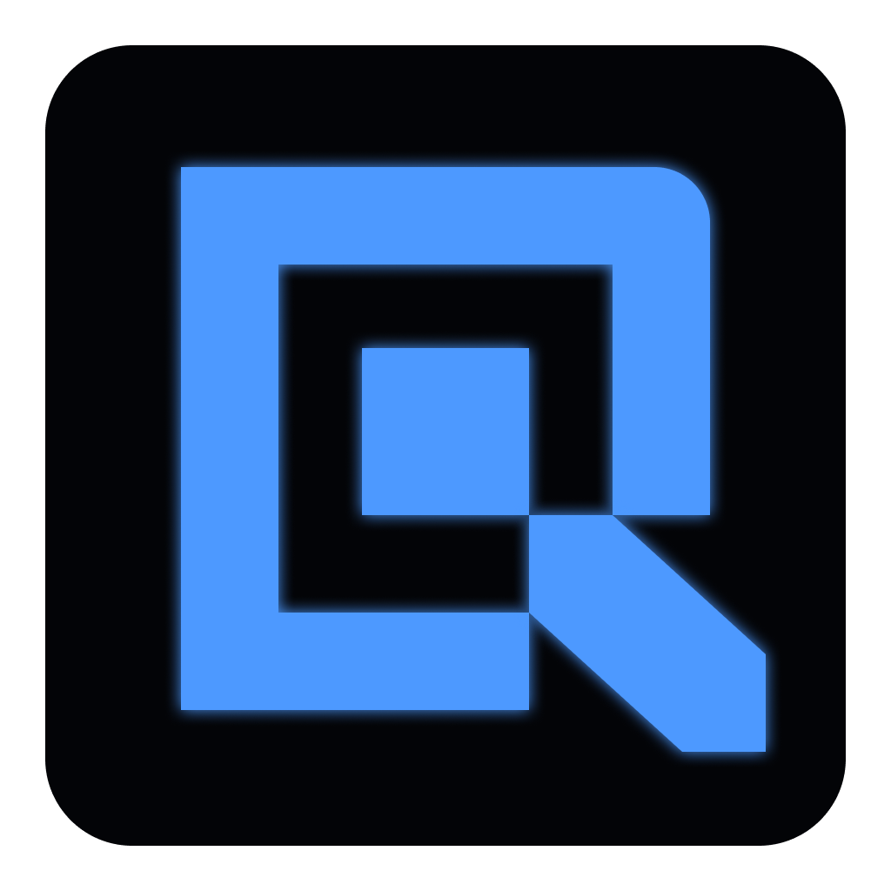

<p align="center">
  
</p>

<h1 align="center">QUIET</h1>

Quiet is a C++20 Vulkan engine project with an integrated editor workflow.

The current focus is an editor-first engine foundation: scene editing, project management, asset registration, viewport tooling, runtime mode switching, serialization, undo/redo, and a modern Dear ImGui-based editor UI.

Quiet is in active prototype development. It is not a production engine yet. The goal is to build a stable, understandable engine foundation one system at a time.

---

## Current Status

Implemented foundations:

* Vulkan renderer with swapchain, depth resources, frame synchronization, scene viewport render target, and static mesh rendering
* Dear ImGui dockspace editor shell
* dark professional editor theme
* high-DPI aware editor UI scaling
* scene viewport with picking, overlays, camera controls, and ImGuizmo editing
* project manager with `.quiet` project descriptors
* scene save/load workflow
* physical project Assets workflow backed by a project-local asset registry
* mesh and texture import/loading foundation
* editor hierarchy with folders, drag/drop ordering, and persistent hierarchy metadata
* dedicated Scene Settings panel for scene-wide lighting and ambient controls
* inspector with actor/component editing
* undo/redo and dirty-state tracking
* Edit / Simulate / Play runtime mode groundwork
* console and diagnostics panels
* editor branding with application icon, window icon, README logo, and topbar logo

---

## Workspace Targets

The workspace currently contains three main targets:

```text
Quiet_Engine   - core static engine library
Quiet_Sandbox  - runtime sandbox executable
Quiet_Editor   - editor executable
```

The editor target is currently the primary development target.

---

## Editor Features

### Editor Shell

* Dear ImGui docking layout
* dark professional editor style
* high-DPI scaling support
* top toolbar with Quiet branding
* resettable default layout
* project manager modal
* docked panels:

  * Viewport
  * Scene / Hierarchy
  * Inspector
  * Scene Settings
  * Assets
  * Console
  * Debug

### Viewport

* scene viewport render target
* viewport picking
* selected actor interaction
* camera navigation
* viewport overlay toolbar
* status overlays
* ImGuizmo integration
* translate / rotate / scale tools
* local/world gizmo mode
* snapping support
* focus selected actor

### Hierarchy

* persistent editor-only hierarchy metadata
* actor rows
* folder rows
* create folder
* rename folder
* delete empty folder
* drag actors into folders
* move actors back to root
* reorder root actors and folders
* drag/drop root ordering
* hierarchy validation and sanitization on load
* undo/redo integration
* save/reload persistence

Folders are editor organization nodes only. They do not change runtime transforms or create parent-child transform relationships.

### Inspector

* actor header
* transform editing
* static mesh editing
* material editing
* directional light component editing
* rotator component editing
* camera component editing
* add component menu
* component action menu
* reset transform action

### Scene Settings

Scene-wide render settings live in a dedicated panel instead of the actor Inspector.

Current controls:

* directional scene light direction
* directional scene light intensity
* ambient color
* ambient intensity
* normalize light direction
* reset directional lighting
* reset ambient
* reset all scene lighting settings

Scene Settings are serialized with the scene and are tracked by dirty-state and undo/redo.

### Assets

* project-local asset registry
* mesh and texture asset records
* built-in resources
* asset reload action
* asset registration UI
* asset file dialog
* search by ID, path, or type
* All / Meshes / Textures filters
* compact asset table
* selected row highlight
* persistent asset details panel
* responsive split layout for wide panels
* texture preview support
* asset details modal
* grid/browser asset view with small, medium, and large thumbnail sizes
* texture thumbnail previews and mesh glyph fallback
* asset reimport workflow
* remove confirmation and asset operation feedback
* physical `Project/Assets` Sources tree
* breadcrumb and parent-folder navigation
* non-recursive current-folder List and Browser views
* import into the selected physical folder with automatic registration
* create, rename, and delete empty physical folders
* drag/drop asset moves between physical folders
* project-relative registry paths for project assets
* missing, invalid, pathless, and external source diagnostics
* diagnostics filters for Issues, Missing, and External assets
* asset context menu:

  * Inspect
  * Copy ID
  * Copy Path
  * Copy Absolute Path
  * Reveal in File Manager
  * Reimport
  * Remove when allowed

### Console / Diagnostics

* editor console panel
* filtered log display
* copy logs to clipboard
* diagnostics/debug panel
* renderer and viewport metrics

---

## Runtime Modes

Quiet currently supports three editor scene modes.

### Edit Mode

Normal editor mode.

* scene editing enabled
* actor selection enabled
* hierarchy editing enabled
* inspector editing enabled
* scene settings editing enabled
* gizmos enabled
* undo/redo enabled

### Simulate Mode

Runtime simulation mode.

* runtime scene clone
* editor scene remains isolated
* editing controls are disabled for runtime safety
* simulation can be stopped and returned to Edit Mode

### Play Mode

Runtime play-testing mode.

* runtime scene clone
* editor interaction disabled
* mouse capture enabled for runtime testing
* returns to Edit Mode when stopped

---

## Project Workflow

Quiet uses `.quiet` project files.

A project descriptor stores:

* project name
* project version
* created/updated timestamps
* startup scene
* scenes directory
* assets directory
* cache directory

Typical project layout:

```text
MyProject/
├── MyProject.quiet
├── AssetRegistry.json
├── Scenes/
│   └── DefaultScene.json
├── Assets/
│   ├── Meshes/
│   └── Textures/
└── Cache/
```

The editor can:

* open an existing project
* create a project
* track recent projects
* open project scenes
* set a startup scene
* reload project assets
* navigate real project asset folders
* import and automatically register assets in the selected folder
* create, rename, and delete empty asset folders
* move registered assets between folders with drag/drop
* diagnose missing and external source paths

---

## Scene Format

Scenes are saved as JSON.

Current serialized data includes:

* actors
* transforms
* static mesh components
* material data
* directional light components
* rotator components
* camera components
* scene render settings
* editor hierarchy metadata

Example hierarchy section:

```json
"editor_hierarchy": {
    "root": [
        {
            "type": "actor",
            "id": "..."
        },
        {
            "type": "folder",
            "id": "..."
        }
    ],
    "folders": [
        {
            "id": "...",
            "name": "Folder",
            "expanded": true,
            "children": []
        }
    ]
}
```

Hierarchy metadata is editor-only and does not affect runtime transforms.

---

## Resources

Engine resources live under:

```text
Engine/Resources/
├── Fonts/
├── Shaders/
└── Textures/
```

Build behavior:

* fonts are copied to the target output directory
* textures are copied to the target output directory
* shaders are compiled with `glslc`
* compiled shaders are written to the target output `Resources/Shaders` directory

---

## Branding Assets

Current branding files:

```text
Docs/Brand/quiet-logo.png
Editor/Resources/Windows/QuietEditor.ico
Editor/Resources/Windows/QuietEditor.rc
Engine/Resources/Textures/Editor/quiet-icon.png
Engine/Resources/Textures/Editor/quiet-topbar.png
```

Usage:

* `quiet-logo.png` is used by this README
* `QuietEditor.ico` is embedded into the Windows editor executable
* `quiet-icon.png` is used as the GLFW window icon
* `quiet-topbar.png` is loaded as an editor texture and shown in the topbar

---

## Fonts and Icons

Included editor UI assets:

* Inter
* JetBrains Mono
* Font Awesome Free Solid

These are used for editor text, mono text, toolbar icons, viewport icons, and compact UI controls.

---

## Build Requirements

Required locally:

* C++20 compiler
* CMake 3.28+
* Ninja
* Vulkan SDK
* `glslc` from the Vulkan SDK

Fetched automatically by CMake:

* GLFW
* spdlog
* GLM
* Dear ImGui docking branch
* ImGuizmo
* ImGuiFileDialog
* nlohmann/json
* Assimp
* stb

---

## Build

### Debug Sandbox

```bash
cmake --preset debug
cmake --build --preset build-debug
```

### Release Sandbox

```bash
cmake --preset release
cmake --build --preset build-release
```

### Debug Editor

```bash
cmake --preset debug-editor
cmake --build --preset build-debug-editor
```

### Release Editor

```bash
cmake --preset release-editor
cmake --build --preset build-release-editor
```

You can also build the editor target directly:

```bash
cmake --build Build/Intermediate/Debug-Editor --target Quiet_Editor -j 14
```

---

## Output Layout

Executables and resources are written to:

```text
Build/Binaries/<Config>/
```

Typical debug editor output:

```text
Build/Binaries/Debug/
├── Quiet_Editor
└── Resources/
    ├── Fonts/
    ├── Shaders/
    └── Textures/
```

On Windows with MinGW, required runtime DLLs are copied next to the executable.

---

## Useful Editor Shortcuts

```text
Ctrl+N              New Scene
Ctrl+S              Save Scene
Ctrl+O              Load Scene
Ctrl+Z              Undo
Ctrl+Y              Redo
Ctrl+Shift+Z        Redo
Ctrl+D              Duplicate Selected
Delete              Delete Selected
F                   Focus Selected
F5                  Play / Stop Play
F6                  Simulate / Stop Simulate
```

---

## Current Development Roadmap

### Completed Recently

* dark professional editor style pass
* high-DPI editor scaling pass
* default dock layout refinement
* editor branding pass
* persistent hierarchy metadata
* hierarchy folders
* hierarchy drag/drop organization
* hierarchy metadata validation
* Scene Settings panel
* scene render settings dirty-state and undo/redo support
* asset browser search and type filters
* persistent asset details panel
* responsive asset details split layout
* asset context menu
* asset browser list/grid view split
* asset import, reload, reimport, remove confirmation, and operation feedback
* physical `Project/Assets` folder tree as the primary asset organization model
* Sources panel for navigating real project folders
* breadcrumb/current folder navigation
* import assets into the selected physical folder
* show only current-folder contents in list/browser views
* create, rename, and delete empty folders
* move assets between folders
* project-relative asset paths by default
* missing/external asset diagnostics

### Upcoming Areas

* viewport grid
* better selection outline/highlight
* snapping controls UI
* camera speed settings
* component copy/paste
* reset component values
* material/mesh assignment UX
* recent scenes per project
* better unsaved-change prompts
* project settings
* runtime/play-mode expansion

---

## Long-Term Direction

Quiet is being developed as a Vulkan-based engine and editor with emphasis on:

* explicit engine/runtime/editor separation
* practical tooling
* predictable scene workflows
* modern C++ architecture
* scalable rendering systems
* editor-first iteration speed

The goal is not to rush features, but to build a stable, understandable engine foundation one system at a time.
