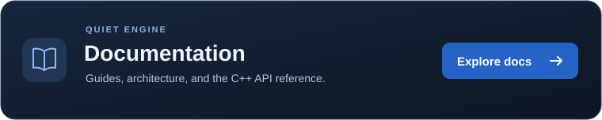

<p align="center">
  
</p>

<h1 align="center">QUIET</h1>

Quiet is a C++20 Vulkan engine with an integrated Editor, project
Launcher, and standalone runtime-package workflow.

It is an actively developed prototype focused on explicit system
ownership, practical tooling, and understandable engine architecture.

<p align="center">
  <a href="https://panuh404.github.io/Quiet-Engine/">
    
  </a>
</p>

## Current capabilities

- Vulkan static-mesh rendering with frame synchronization, an offscreen
  Editor viewport, adaptive grid, picking, and selection outlines.
- EnTT-backed Actors and components with JSON Scene persistence.
- Dear ImGui Editor with hierarchy folders, component inspection,
  transform gizmos, viewport navigation, undo/redo, and dirty tracking.
- Project Launcher with discovery, creation, recent projects, and
  Editor handoff.
- Asset importing, inspection, previews, assignment, and project-file
  organization.
- Jolt fixed-step physics with Static, Dynamic, and Kinematic bodies,
  primitive colliders, contact events, and runtime commands.
- miniaudio playback with spatial sources, listeners, audio buses,
  playback controls, and Editor previews.
- Lua scripting with per-Actor environments, callbacks, exposed
  properties, engine bindings, deferred Actor requests, and hot reload.
- Asset cooking with optimized QMesh geometry, BC7 sRGB QTexture data,
  native audio/Lua packaging, validated cache reuse, and runtime manifests.

Play and Simulate use disposable runtime Scene copies, preserving
the editable Scene.

## Quick start

The documented workflow uses Windows and PowerShell. Run these commands
from the repository root with the selected compiler environment available.

Requirements:

- Git.
- CMake 3.28 or newer.
- Ninja.
- A C and C++20-capable toolchain.
- Vulkan headers, loader library, and glslc.
- A compatible graphics driver.
- Khronos validation layers for Debug Editor and Sandbox.
- Network access for initial dependency fetching.

Build the Launcher and its Editor dependency:

```powershell
cmake --preset debug-launcher
cmake --build --preset build-debug-launcher
```

Launch from the output directory:

```powershell
Push-Location .\Build\Binaries\Debug
try {
    .\Quiet_Launcher.exe
}
finally {
    Pop-Location
}
```

Select + New Project or open an existing project.

Keep the executables, Resources directory, and required runtime libraries
together.

See [Getting Started](Docs/GettingStarted.md) for toolchain setup,
other presets, resources, and troubleshooting.

## Workspace targets

| Target | Responsibility |
| --- | --- |
| Quiet_Engine | Shared static engine library |
| Quiet_Launcher | Project discovery, creation, and Editor launch |
| Quiet_Editor | Scene authoring and runtime testing |
| Quiet_Sandbox | Standalone runtime and package loading |
| Quiet_Cooker | Asset conversion and runtime-package production |

Executable outputs use Build/Binaries/Debug or Build/Binaries/Release.
Presets keep intermediate build directories separate.

## Documentation

Start with the [documentation index](Docs/README.md).

| Goal | Read |
| --- | --- |
| Build and launch | [Getting Started](Docs/GettingStarted.md) |
| Create or open a project | [Projects](Docs/Guides/Projects.md) |
| Edit and test a Scene | [Editor guide](Docs/Guides/Editor.md) |
| Import and organize assets | [Assets guide](Docs/Guides/Assets.md) |
| Write Lua behavior | [Scripting guide](Docs/Guides/Scripting.md) |
| Cook and launch a package | [Cooking guide](Docs/Guides/Cooking.md) |
| Understand implementation | [Architecture](Docs/Architecture.md) and system chapters |
| Inspect persisted data | [File formats](Docs/Reference/FileFormats.md) |
| Follow engine direction | [Roadmap](Docs/Roadmap.md) |

Optional Doxygen generation provides a browsable C++ reference.
See [Building the documentation](Docs/Contributing/BuildingDocumentation.md)
for setup and diagnostics.

Generated documentation belongs under Build/Docs and is not committed.

## Scope and maturity

Quiet currently provides an engine foundation rather than a complete
production toolchain.

Hierarchy folders organize the Editor; they do not establish transform
parenting. Runtime changes are discarded when Play or Simulate stops.

Cooked textures currently use BC7 sRGB. Audio retains native files, and
scripts remain Lua source. A runtime package contains content and metadata;
the Cooker does not assemble an executable distribution.

Detailed validation, failure behavior, and current limitations are
documented in the system chapters.

## Technology

Quiet uses Vulkan, GLFW, Dear ImGui, ImGuizmo, EnTT, Jolt Physics,
miniaudio, Lua with sol2, Assimp, and supporting libraries.

Cooking uses meshoptimizer, Zstandard, KTX-Software, and Compressonator.
CMake declares and fetches the build dependencies.

## License

Quiet is distributed under the [MIT License](LICENSE).
Third-party dependencies and bundled assets retain their respective licenses.